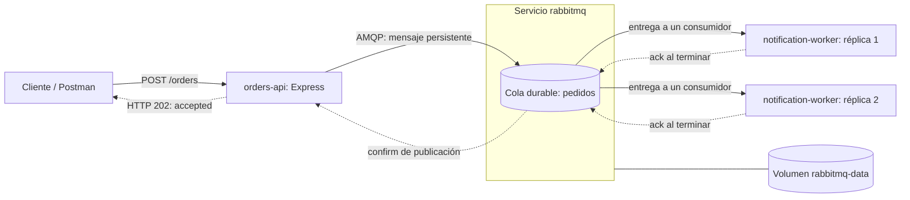

# Arquitectura basada en mensajes — RabbitMQ

Laboratorio Node.js/Express: API → cola RabbitMQ → dos réplicas consumidoras. **Tres servicios Compose, cuatro contenedores**; no hay que lanzar cada worker por separado. La ruta de ejecución documentada usa Windows PowerShell sin WSL; la verificación histórica disponible fue en Linux/WSL2, no Windows nativo.

## Integrantes

- Juan David Velasquez Murillo
- Paula Andrea Calderon Quintero
- Sara Regino Ferraro
- Alejandra Madrid Calderon

## Entrega RabbitMQ — 10 de 10 casos

- **[Informe PDF consolidado](entrega/Informe_RabbitMQ.pdf)**: diez casos completos, análisis y siete capturas con su procedencia; CP-12 muestra un detalle identificado con enlace al original completo.
- [Informe fuente y referencias](docs/entrega/INFORME_RABBITMQ.md), [mapa de casos](docs/ARQUITECTURA_RABBITMQ.md) y [verificación de entrega](docs/entrega/VERIFICACION_ENTREGA.md).
- Código, Compose, colección Postman y evidencias incluidos. También puede descargarse el repositorio desde **Code → Download ZIP**.

Este repositorio completa **la parte RabbitMQ**, no los veinte casos del taller: Kafka y la comparación experimental global siguen fuera de su alcance. Los estados Cumple son conclusiones de nuestros reportes, no una calificación del profesor.

## Arquitectura real



Las réplicas **compiten por la misma cola**: no es fanout ni una copia por worker. Cada una usa `prefetch(1)`, simula 3000 ms de trabajo y envía ack manual al terminar. El 202 espera confirmación del broker, no la notificación. Puede haber reentrega; no hay deduplicación ni garantía de exactamente una vez. [Decisiones, código y diez casos](docs/ARQUITECTURA_RABBITMQ.md).

## Inicio rápido

Requisitos: Windows compatible con Hyper-V, Docker Desktop **con backend Hyper-V y Linux containers**, Compose v2 actualizado y Git para Windows. Para el runner de integración, Node.js 24 en Windows. Consulte primero [instalación y restricciones de Windows](docs/EJECUCION_WINDOWS.md).

Desde PowerShell, en una carpeta de trabajo:

```powershell
git clone https://github.com/paucq/ArquitecturaBasadaEnMensajesRabbitMQ.git
Set-Location .\ArquitecturaBasadaEnMensajesRabbitMQ
powershell -NoProfile -ExecutionPolicy Bypass -File .\scripts\windows\Start-Lab.ps1
Invoke-RestMethod -Uri http://localhost:3000/health -TimeoutSec 5
```

Resultado: `status: ready`, 4 contenedores activos (API, broker y 2 workers). Management: http://localhost:15672, usuario/contraseña **admin/admin**, exclusivamente para laboratorio local. Todos los puertos se publican en loopback; no exponer estas credenciales ni este entorno a Internet.

### Enviar y comprobar un pedido

```powershell
$body = @{ customerName = 'Pedro'; product = 'Libro de arquitectura'; quantity = 1 } | ConvertTo-Json
$pedido = Invoke-RestMethod -Method Post -Uri http://localhost:3000/orders -ContentType 'application/json' -Body $body -TimeoutSec 5
$pedido
```

Se espera HTTP 202, `status: accepted` y `orderId`. Esto confirma publicación en el broker, **no** notificación terminada. En Management → Queues and Streams → `pedidos` observe Ready/Unacked; un pedido puede desaparecer rápidamente al ser procesado.

```powershell
docker compose --project-name arquitectura-basada-mensajes-rabbitmq --file .\rabbitmq\docker-compose.yml logs --timestamps orders-api notification-worker
powershell -NoProfile -ExecutionPolicy Bypass -File .\scripts\windows\Test-Lab.ps1
```

El runner necesita Node.js 24 y Docker CLI en Windows. Instala dependencias con `npm ci`, detiene temporalmente ambos workers, envía pedidos y reencola mensajes inspeccionados. Usar una cola con menos de 100 mensajes pendientes, sin otro operador ni pruebas concurrentes. Comprueba dos tests (positivo y cantidad cero), **no los diez casos formales**. No purga la cola; puede cambiar su orden. Ver [Postman local y procedimiento detallado](docs/EJECUCION_WINDOWS.md#postman-local).

### Apagar conservando datos

```powershell
powershell -NoProfile -ExecutionPolicy Bypass -File .\scripts\windows\Stop-Lab.ps1
```

Ejecuta `down` sin `-v`: elimina contenedores/red del proyecto pero conserva el volumen. No usar `-v` durante ensayos de persistencia o recuperación.

## Otro laboratorio ya ocupa los puertos

Use **los mismos parámetros en los tres scripts**; no se alteran otros proyectos:

```powershell
powershell -NoProfile -ExecutionPolicy Bypass -File .\scripts\windows\Start-Lab.ps1 -ProjectName qa-rabbitmq-entrega-verificacion -ApiPort 3300 -ManagementPort 15673 -AmqpPort 5673
powershell -NoProfile -ExecutionPolicy Bypass -File .\scripts\windows\Test-Lab.ps1 -ProjectName qa-rabbitmq-entrega-verificacion -ApiPort 3300 -ManagementPort 15673 -AmqpPort 5673
powershell -NoProfile -ExecutionPolicy Bypass -File .\scripts\windows\Stop-Lab.ps1 -ProjectName qa-rabbitmq-entrega-verificacion -ApiPort 3300 -ManagementPort 15673 -AmqpPort 5673
```

En ese caso use API `http://localhost:3300` y Management `http://localhost:15673`. Los scripts restauran las variables de proceso al salir; no guardan configuración ni secretos. El nombre del proyecto delimita contenedores, red y volumen.

## Mapa de la entrega

Árbol resumido de rutas reales; las corridas originales no se desplazan:

```text
ArquitecturaBasadaEnMensajesRabbitMQ/
├── README.md
├── rabbitmq/
│   ├── api.mjs                   # HTTP y publicación confirmada
│   ├── broker.mjs                # Conexión AMQP y logs compartidos
│   ├── worker.mjs                # Consumidor con ack manual
│   ├── docker-compose.yml       # 3 servicios / 4 contenedores
│   ├── Dockerfile
│   ├── package.json / package-lock.json
│   └── pruebas/                 # Colección Postman y 2 tests de integración
├── scripts/windows/             # Start-Lab, Test-Lab, Stop-Lab
├── docs/
│   ├── ARQUITECTURA_RABBITMQ.md
│   ├── EJECUCION_WINDOWS.md
│   └── entrega/                 # Informe fuente, manifiesto y verificaciones históricas
├── entrega/Informe_RabbitMQ.pdf
├── evidencias/rabbitmq/          # 1045 archivos originales y diez reportes
└── tools/                       # Generador PDF, requisitos y tests
```

| Ruta | Uso |
|---|---|
| [rabbitmq/](rabbitmq/) | Aplicación, Compose y pruebas iniciales |
| [docs/EJECUCION_WINDOWS.md](docs/EJECUCION_WINDOWS.md) | Preparación, Postman y diagnóstico |
| [docs/ARQUITECTURA_RABBITMQ.md](docs/ARQUITECTURA_RABBITMQ.md) | Explicación y acceso a los diez casos |
| [evidencias/rabbitmq/](evidencias/rabbitmq/) | Evidencia histórica original; conservar rutas relativas |
| [docs/entrega/](docs/entrega/) | Auditoría, informe y fuentes de la entrega |
| [entrega/](entrega/) | PDF final |

Las evidencias originales incluyen comandos Linux/WSL: describen corridas históricas, **no son instrucciones para repetir en Windows**. Capturas derivadas de salida guardada están identificadas como tales, nunca como una nueva validación Windows.

## Verificación efectuada y límite de plataforma

Los tres scripts Start/Test/Stop pasaron con PowerShell 7.6.9 en un proyecto Docker aislado, **2/2 tests** aprobados y cero errores en el parser. El proyecto histórico no se alteró. [Comandos, salidas y plataforma exacta](docs/entrega/VERIFICACION_ENTREGA.md#comprobación-funcional-desde-powershell).

La comprobación disponible se realizó con **PowerShell sobre Linux/WSL2**, no en Windows/Hyper-V. No se afirma una ejecución nativa de Windows PowerShell 5.1 ni Hyper-V. La ruta de instalación documentada para otra máquina sí evita WSL usando Hyper-V y Linux containers en una edición Windows compatible.

### Reconstruir el informe (opcional)

No se necesita Python para ejecutar la aplicación. El PDF ya está incluido. Para regenerarlo desde PowerShell con Python 3.11 o posterior instalado:

```powershell
py -3 -m venv .venv
.\.venv\Scripts\python.exe -m pip install -r .\tools\requirements-informe.txt
.\.venv\Scripts\python.exe .\tools\generar_informe.py
```

El generador lee los reportes e imágenes conservados y produce el informe fuente, el PDF y su comprobación. No publica pedidos ni modifica la aplicación.
